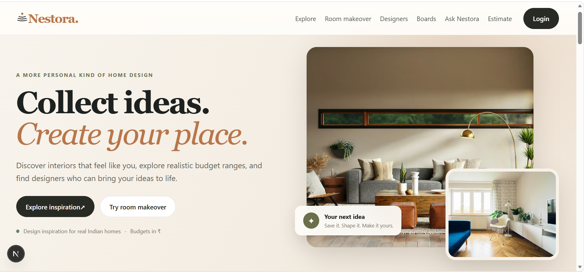
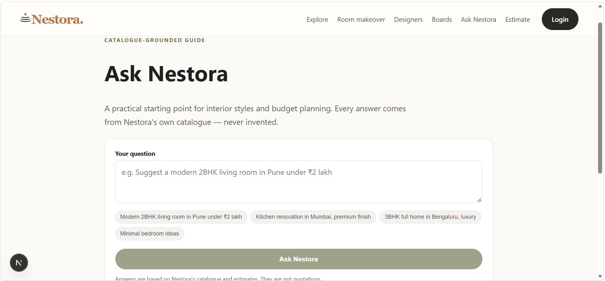
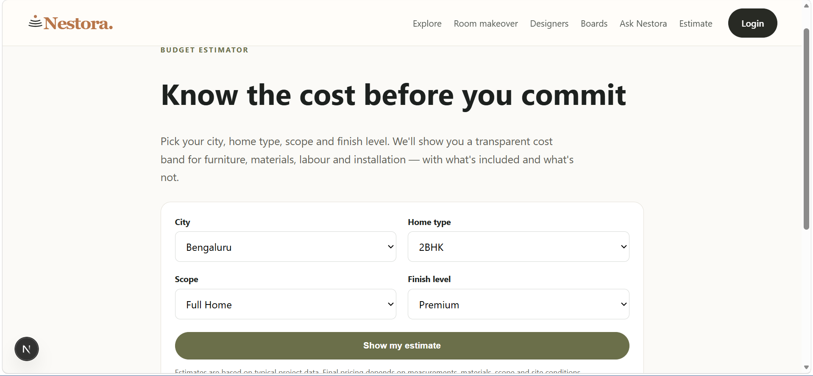
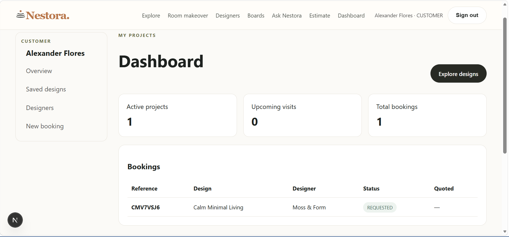

# Nestora — Interior Design Discovery & Booking Platform

Nestora is a web platform concept for discovering interior design inspiration, exploring designer portfolios, saving ideas, requesting consultations, and estimating home-interior budgets. It uses a warm, editorial visual style inspired by natural materials and contemporary Indian homes.

> **Project status:** This is a development/demo project. Review the setup and verification notes below before deploying it publicly. The Ask Nestora page shown in the screenshots is a catalogue-grounded scaffold, not a fully integrated generative-AI assistant.

## Screenshots

### Home — discover interior designs
<<<<<<< HEAD


### Designers — browse professional profiles


### Ask Nestora — catalogue-guided planning


### Budget estimator


### Customer dashboard
=======


### Designers — browse professional profiles


### Ask Nestora — catalogue-guided planning


### Budget estimator


### Customer dashboard

>>>>>>> 19ec159 (Fix README screenshot links)


Screenshots are from the local development interface and may show demo data or incomplete areas. They are included to document the current UI, not to claim production readiness.

## Main features

- Browse interior design concepts and styles
- View designer profiles and portfolios
- Save favourite designs and organize inspiration boards
- Request bookings and consultations
- Estimate project budgets using city, home type, scope, and finish level
- Customer dashboard for personal projects and booking information
- Admin workspace for managing catalogue and incoming requests (depending on configured database/schema)
- Local image assets in `public/images/`

## Tech stack

- Next.js App Router and React
- TypeScript
- Auth.js credentials authentication
- Prisma ORM 7
- PostgreSQL
- CSS and Tailwind/shadcn-based UI components where used in the project

## Requirements

- Node.js 22 LTS recommended for the current local setup
- npm
- PostgreSQL database (local or hosted)

## Setup on Windows (PowerShell)

1. Clone the repository or open the project folder.
2. Create your local environment file:

   ```powershell
   Copy-Item .env.example .env
   ```

3. Edit `.env` and set your PostgreSQL `DATABASE_URL` and a strong `AUTH_SECRET`. Never commit `.env`.
4. Install packages and generate Prisma Client:

   ```powershell
   npm install
   npx prisma generate
   ```

5. Apply the database schema. If the project has migrations, inspect status first:

   ```powershell
   npx prisma migrate status
   ```

   Apply migrations only after reviewing the output. If this development project is intentionally using schema push instead of migrations, use `npx prisma db push` against a development database.

6. Seed sample data if configured:

   ```powershell
   npm run db:seed
   ```

7. Start the app:

   ```powershell
   npm run dev
   ```

8. Open [http://localhost:3000](http://localhost:3000).

## Environment variables

See `.env.example` for the variable names expected by this project. Typical values include:

- `DATABASE_URL` — PostgreSQL connection string
- `AUTH_SECRET` — secret for signing authentication tokens/sessions
- `AUTH_TRUST_HOST` — host trust setting if required by Auth.js
- `AUTH_URL` — local or deployed application URL, if required by the configured auth setup
- `NEXT_PUBLIC_APP_NAME` — public application name

Use your own credentials and a separate development database for sample data. Do not put real secrets in `.env.example`.

## Useful commands

```powershell
npm run dev        # Start development server
npm run typecheck  # TypeScript check, if configured
npm run build      # Production build
npm run db:seed    # Add sample data, if configured
```

## Repository structure

```text
app/                  Next.js pages and API routes
components/            Shared UI components
lib/                   Authentication, Prisma, and application helpers
prisma/                Prisma schema and seed scripts
public/images/         Local interior and material images
screenshots/      UI screenshots embedded in this README
```
